<picture>
  <source media="(prefers-color-scheme: dark)" srcset="assets/banner-dark.svg">
  
</picture>

## Projets

<table>
  <tr>
    <td width="50%" valign="top">
      <b><a href="https://github.com/Gecnos/Dating-app-">Dating-app-</a></b> 
      Application de rencontres pour le marché béninois : profils, matching, messagerie en temps réel. 
      Laravel 12 · React 19 
      <i>Chef de projet et développeur</i>
    </td>
    <td width="50%" valign="top">
      <b><a href="https://github.com/Gecnos/wamon">Wamon</a></b> · <a href="https://wamon.dev-vianney.me/">site</a> 
      Le labo dans la classe pour les profs de physique-chimie : 8 exercices du programme, hors ligne une fois chargé. 
      React · TypeScript · Vite 
      <i>Chef de projet et développeur</i>
    </td>
  </tr>
  <tr>
    <td width="50%" valign="top">
      <b><a href="https://github.com/Gecnos/marketplace">Services Locaux</a></b> 
      Mise en relation de clients et de prestataires locaux : plombiers, électriciens, etc. Migration vers React en cours. 
      Laravel · React 
      <i>Chef de projet et développeur</i>
    </td>
    <td width="50%" valign="top">
      <b><a href="https://github.com/Gecnos/facedebouc">Clone Facebook</a></b> 
      Réseau social inspiré de Facebook. 
      <i>Chef de projet</i>
    </td>
  </tr>
  <tr>
    <td width="50%" valign="top">
      <b><a href="https://github.com/Gesnotes">Gesnotes</a></b> 
      Suivi des notes scolaires en temps réel : API et interface web pour écoles et enseignants. Repos <a href="https://github.com/Gesnotes/backend">backend</a> et <a href="https://github.com/Gesnotes/frontend">frontend</a>. 
      Express · TypeScript · PostgreSQL · React 
      <i>Chef de projet et développeur</i>
    </td>
    <td width="50%"></td>
  </tr>
</table>

## Stack

Frontend : HTML5, CSS3, JavaScript, TypeScript, Angular, React, Tailwind CSS, Vite

Backend : PHP, Laravel, Python, Express

Base de données : MySQL, PostgreSQL

Outils et DevOps : Git, GitHub, Docker

Design : Figma

## Expériences

**Fondateur, Digital Presse** : depuis mai 2025. Plateforme média-tech mobile qui numérise la presse écrite béninoise.

**Stage au SPTIC, Université d'Abomey-Calavi (UAC)** : février à mai 2026

## Stats GitHub

17 repos publics · 16 abonnés · 24 abonnements · sur GitHub depuis novembre 2024

## Contact

- LinkedIn : [linkedin.com/in/vianney-houeho-a25a96361](https://www.linkedin.com/in/vianney-houeho-a25a96361)
- Email : [contactme@dev-vianney.me](mailto:contactme@dev-vianney.me)
